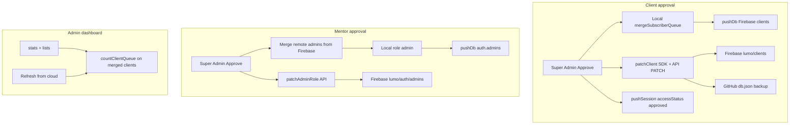

# Registration Approval System — Audit Report

**Date:** 2026-07-21  
**Branch:** `cursor/approval-system-audit-8f6d`  
**Scope:** Client + mentor registration approval (DB → API → UI)

---

## Executive summary

The approval system had **multiple sources of truth** (Firebase RTDB, GitHub `cloud-data/db.json`, local prepaid seed, local tombstones) with **inconsistent counting** and **server writes that did not always reach Firebase**. Approvals could appear locally but not persist on other devices when the client SDK write failed and the API fallback only updated GitHub backup.

This audit standardizes status handling, fixes dashboard count mismatches, adds server-side Firebase mirrors for PATCH operations, fixes mentor approval for Firebase-only registrations, and adds structured logging across the flow.

---

## Root causes

### Issue 1 — Client approval not persisting

| # | Root cause | Impact |
|---|------------|--------|
| 1 | `PATCH /api/clients/:id` updated GitHub backup only — **not Firebase** | Other devices polling Firebase still saw `pending` |
| 2 | `patchClient()` returned after first Firebase attempt; API fallback skipped when Firebase returned null slowly | Approval never reached durable backup |
| 3 | Local 2.5s poll merged remote `pending` with local `approved` — merge logic was correct (`pickClientStatus`), but **without Firebase write other devices never saw approval** | Cross-device inconsistency |
| 4 | License release previously reset payment flags (fixed in PR #52); session `accessStatus` now preserves `approved` when client status is approved | Kick-out no longer demotes approved clients |

### Issue 2 — Mentor registration missing from admin panel

| # | Root cause | Impact |
|---|------------|--------|
| 1 | `flushApproveQueue` only mapped **`prev.admins`** — mentors registered on another device existed only in Firebase until sync | Approve button could no-op for IDs not yet in local state |
| 2 | Super Admin `auth.admins` depends on `fetchAdmins()` poll + Firebase watch; if local list was stale, pending mentors were invisible until sync | "No registrations pending" while users saw login block message |
| 3 | Mentor approval had **no dedicated server PATCH** to Firebase `lumo/auth/admins` | Role change relied solely on client `pushDb` |

Users stuck on **"Your admin account is waiting for Super Admin approval"** (`AdminContext.login`) because `role === 'pending'` in Firebase — correct behavior when not yet approved, but admin couldn't see them when local registry was incomplete.

### Issue 3 — Database audit / single source of truth

| Store | Approval field | Role |
|-------|----------------|------|
| Firebase `lumo/clients` | `status: 'pending' \| 'approved' \| 'rejected'` | **Live client queue (source of truth)** |
| GitHub `cloud-data/db.json` clients | same `status` field | Durable backup |
| Prepaid seed (`PREPAID_CLIENTS`) | injected as `approved` | Legacy bootstrap only |
| Client session | `accessStatus: 'none' \| 'pending' \| 'approved' \| 'paid' \| 'licensed'` | Per-device UX state |
| Firebase `lumo/auth/admins` | `role: 'pending' \| 'admin' \| 'super'` | **Mentor approval source of truth** |

**Conflicting flags eliminated:** all client merges now use `pickClientStatus()` with normalization; mentor merges use role rank (`admin` beats `pending`).

### Issue 4 — Status consistency

Previously some paths compared raw `c.status === 'approved'` while merges could produce mixed casing. Now:

- **`ClientRequest.status`** — canonical client field (`src/lib/clientQueue.ts`)
- **`AdminUser.role`** — canonical mentor field
- **`Session.accessStatus`** — client app session only (synced via `pushSession` on approval)

### Issue 5 — Admin dashboard count mismatch (screenshot)

Observed: **61 awaiting**, **0 approved**, refresh message **"0 awaiting, 236 approved"**.

| Widget | Old source | Problem |
|--------|------------|---------|
| Awaiting stat | `clients.filter(pending)` | Live Firebase pending (61) |
| Approved list | `clientRequests.filter(approved)` | Prepaid seed tombstoned locally → 0 approved |
| Refresh message | Raw `fetchClients()` counts **before** prepaid/deleted merge | Showed stale GitHub-only numbers (236 approved, 0 pending) |

**Fix:** `refreshClientQueue()` now returns counts from **`mergeSubscriberQueue()`** — same function used for stats and lists.

---

## Fixes applied

### New files

| File | Purpose |
|------|---------|
| `src/lib/approvalLog.ts` | Structured `[approval:client\|mentor]` logging |
| `src/lib/clientQueue.ts` | `normalizeClientStatus`, `pickClientStatus`, `countClientQueue` |
| `api/_lib/clientMerge.mjs` | Shared server merge + `firebasePatchClientById` + `firebasePatchAdminRole` |

### Modified files

| File | Changes |
|------|---------|
| `src/context/AdminContext.tsx` | Central `mergeSubscriberQueue`; fixed refresh counts; mentor approve merges remote admins first; client/mentor approval logging |
| `src/lib/remote.ts` | `patchClient` always tries API after Firebase; new `patchAdminRole` |
| `api/index.js` | `PATCH /api/clients/:id` writes Firebase; new `PATCH /api/auth/admins/:id` |
| `api/_lib/handlers.mjs` | Parity: merged GET clients/db; PATCH writes Firebase; admin role PATCH |
| `src/pages/admin/AdminPages.tsx` | Normalized status filters on Subscriptions page |
| `src/pages/client/WaitingApprovalPage.tsx` | Normalized status checks for client waiting flow |

---

## Logging added (Issue 6)

Console tags: `[approval:client]` and `[approval:mentor]`

| Event | Tag |
|-------|-----|
| Registration created | `registration_created` |
| Approve clicked | `approve_clicked` |
| Status before/after | `status_before_update`, `local_state_updated` |
| DB write success/failure | `database_update_success`, `database_update_failure` |
| Cloud patch | `cloud_patch_success`, `cloud_patch_timeout`, `cloud_patch_failure` |
| Session sync | `session_sync_success`, `session_sync_failure` |
| Queue refresh | `queue_refreshed` |
| Mentor sync | `registration_synced` |

---

## End-to-end test plan (Issue 7)

Run on **production** (`lumoedge.com`) after deploy:

### Client flow

1. Register new client (non-prepaid email)
2. Super Admin → Subscriptions: verify pending count + list match
3. Tap **Approve** → verify instant move to Approved section
4. Refresh browser → still approved
5. Client device: waiting page auto-advances to license activation
6. Log out / back in on client → still approved
7. Second admin device: refresh queue → same approved state

### Mentor flow

1. Register new mentor on Admin Portal
2. Super Admin → Approve Admins: pending appears within ~2.5s
3. Tap **Approve**
4. Mentor logs in → reaches dashboard (not waiting message)
5. Refresh Super Admin → mentor in Approved list
6. Second device → same state after sync

### Automated verification (local)

```bash
cd unlimited-bull-web && npm run build
```

Build: **PASS** (tsc + vite)

---

## Architecture (after fix)



---

## Residual risks

1. **Prepaid tombstones** — locally deleted emails won't appear in Approved list even if in GitHub backup; intentional.
2. **Firebase rules** — if client SDK writes are blocked, server PATCH now provides a second path (requires server egress to Firebase REST).
3. **Large queue** — 60+ pending clients is expected live volume; prepaid seed no longer inflates pending counts when tombstoned.

---

## Recommendation

Deploy this branch and verify on production with one real client + one mentor test account. Monitor browser console for `[approval:*]` logs during approve actions.
